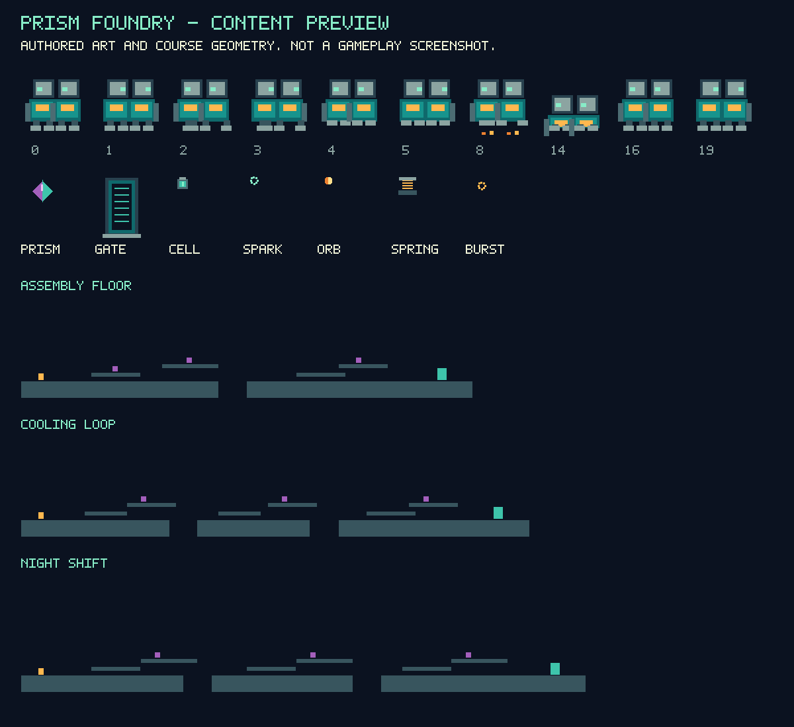

# Prism Foundry: independently authored content and native parser checks

The Moon Child FE source-port work now has a **three-course independently authored content pack**, with graphics, animation poses, palette, block glyphs, maps, placement specifications and original text dedicated under CC0. The native content checks passed. **No game was started or integrated, and no gameplay result is claimed.** Catalog remains **90**; no additional decompilation is counted.

## Authorship and licensing

The [generator and native-test recipe](../experiments/prism-foundry-content/README.md) use MIT. The new content uses a [scoped CC0 dedication](../experiments/prism-foundry-content/CC0.txt), separate from upstream source and dependencies. No original game media, reference screenshots, maps, animation data, font files, music, effects, movies or story text were inputs. The block glyph definitions, geometric robot, moving poses, prism/gate/effect graphics, industrial background and tiles are authored in the generator. Functional format and interface names were inspected in pinned source; this does not certify clean-room isolation.

The [official CC0 legal code](https://creativecommons.org/publicdomain/zero/1.0/legalcode.txt) is copied separately: **7,048 bytes**, SHA-256 `a2010f343487d3f7618affe54f789f5487602331c0a8d03f49e9a7c547cf0499`. It is explicitly identified as a Creative Commons license document, not newly authored campaign media. The dedication does not relicense Moon Child FE, third-party dependencies, original retail files or trademarks. Code, asset and dependency scopes remain separate.

## Concrete pack

The [per-file provenance manifest](../experiments/prism-foundry-content/provenance.json) records **276 files**, **469,902 bytes**, plus the manifest itself. It includes **265 PCX images**, one animation descriptor, three native tile maps, three collision grids, authored course/placement/objective text, the loader opt-in marker and notices. There is no audio; the null backend remains required.

The three authored courses are Assembly Floor, Cooling Loop and Night Shift. Their intended objective is to collect three prisms and enter a gate. Those are **untested design specifications**, not earned objectives or balanced-route results. Their geometry, spawn/checkpoint/gate positions and text are independent of the original levels. Twelve animation IDs are supplied for the initial content path; the rest of the original game's animation set is absent.

Two fresh C: generations matched **all 277 files including the manifest**. A deterministic local data-only ZIP was reread and compared against every member: **305,355 bytes**, SHA-256 `c23e0531351b1aaae94282d71a1c2ed41b11aa740f1fcd304bc17e6945c2bc47`. It contains no game runtime, upstream code or complete corresponding-source distribution. No runtime/source archive was uploaded or website deployment performed.

## Native verification, precisely scoped

The harness links the actual **87 non-main objects** from the [88-unit adapted build](moonchild-independent-adapters-2026-10-15.md), with a separate test main. It retains upstream PCX, animation parser, animation stepping, map-file reader and collision sampler implementations. It initializes no game Host, loop, video or audio, and uses no stand-in implementations of those tested native functions.

Measured checks cover:

- **265 native PCX decodes**, comparing SHA-256 hashes over **1,413,900 pixel indices** and **203,520 palette bytes** against generator-derived expectations. Node's crypto hashes the actual native-decoded WASM buffers.
- Native animation parsing of **258 frames**, **32 sequences** and **12 animations**, followed by valid frame selection and stepping across **252 sequence slots**.
- Three authored native tile-map reads with byte fingerprints and tile-index checks.
- Three authored native collision-grid reads and **22,016** native center-of-cell samples, plus six out-of-bounds checks.

The first harness compile failed because the `MAP_DESCR` definition header was missing; adding `editor.hpp` fixed it. The final manifest adds explicit origin metadata for the verbatim license document. All pack payload bytes stayed unchanged. The exact final pack also passed the native harness after that metadata change. The preview was visually inspected; it is labeled as authored art/course geometry, not a gameplay screenshot.

A temporary loss of D: access interrupted one final replay attempt. C: regeneration preserved the work; D: returned, all **221 pinned source hashes** still matched, and the native test was rerun. This was a storage availability interruption, not a gameplay failure. No drive action remains required while the inputs stay accessible.

## Remaining release gates

The pack is not selected by an integrated game. Source-side level initialization, placements and triggers still need authored selection; remaining expressive UI/story/font/animation tables need review/replacement. Native animation bounds and missing-content initialization also need attention: the retained animation code has a frame-limit comparison and descriptor sequence-capacity boundary that should be hardened before integration. The supplied descriptor stays within 21 concrete slots; valid-index stepping tests do not prove arbitrary-input safety.

The game still needs ordinary movement/objective/hazard/death/retry tests, a complete three-course playthrough, save restoration and Stop, final SDK/runtime/dependency notices, shipping allowlists, corresponding source and muted production verification. The [earlier Microsoft loader replacement and separate source/media grant boundaries](moonchild-independent-adapters-2026-10-15.md) continue to apply. No root-MIT blanket clearance, original campaign availability, clean-room certificate or new permissive-release count is asserted. Mario Party 2/3, Halo and private ROM research were untouched. No players or test servers were left running.

[Machine-readable checkpoint](prism-foundry-content-2026-10-15.json).
