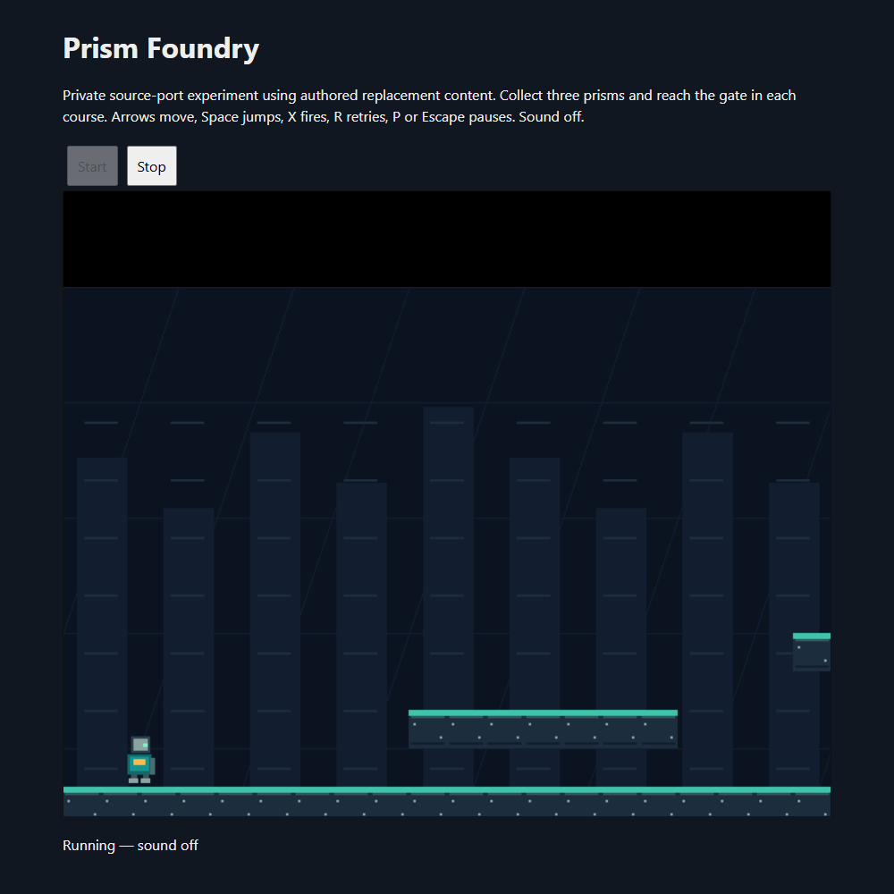

# Prism Foundry private player: startup and partial gameplay

The Moon Child FE developer-source port now runs its first independently authored course in a private browser build. Muted tests pass startup, normal movement/jump, pause/resume, retry, two pickups, a gap fall/respawn, fresh restart and native Stop. **No new catalog entry, complete course/campaign, save restoration or production release is claimed.** Catalog stays at **90**; this source port adds no decompilation.

## Build and content scope

The [recipe](../experiments/prism-foundry-integration/build-player.py) checks the pinned base source/overlays, all 277 pack files including the manifest, and **83 retained native object hashes**. It compiles six changed/new units and links with strict undefined-symbol checking, assertions and SAFE_HEAP. Original actor movement, scrolling, collision and pickup implementations remain native. The compiled object set was not independently rebuilt in full for this checkpoint, and SAFE_HEAP is not a full memory-safety or leak certificate. The patched legacy MC unit still emits 86 warnings.

The candidate embeds only the existing authored pack, whose [provenance manifest](../experiments/prism-foundry-content/provenance.json) is unchanged. No original retail media, ROM, movie, soundtrack, map or asset archive was loaded. The authored campaign is selected directly; original movie/menu/progress/recording flows and editor shortcuts are bypassed. Original palette/world-specific presentation calls are omitted. A pickup bonus uses the authored burst animation. The replacement fall path calls native `hoi_init` at the current spawn/checkpoint; it does not verify the original rise/collapse animation. Native first-course initialization and the authored gate callback now execute, but reaching the checkpoint and passing a gate remain unverified.

This remains an original-developer source port with original replacement content. The original-programmer MIT code grant, excluded NC/NC-SA original media, separately replaced Microsoft loader, GLAD/registry notices and final selected SDL/Emscripten runtime closure remain separate scopes. No root-license blanket clearance or clean-room certificate is asserted. Unused original source-side tables and campaign/UI routines still exist and require review/removal before shipping.

## Measured muted browser checks

The [test driver](../experiments/prism-foundry-integration/test-player.mjs) launches headless Edge through Playwright with `--mute-audio`. Inputs are keyboard actions; exported state is read-only. No actor coordinate, pickup count, checkpoint or completion flag is changed by the test.

- First-course startup: native loop reaches 21 ticks, actor at `(80,592)`, editor disabled.
- Right movement: actor reaches `(147,592)`; Space jump reaches `(172,550)`.
- Pause: actor and tick counter stay unchanged over a 300 ms observation, then ordinary P resumes.
- N does not skip the course or grant pickups; editor remains disabled.
- R reloads the current course at spawn, with zero collected prisms.
- Partial route earns pickup counts **1**, then **2** through native collision/pickup callbacks. The first attempt missed the first pickup; backtracking on the ledge corrected the input route without changing game state.
- Walking into the floor gap increments the campaign respawn count to **1**, returns to `(80,592)`, and retains both collected prisms. This verifies the adapted fall/respawn path, not the original death animation.
- Stop observes native Host readiness become false before iframe removal. Starting a fresh player restores initial zero-pickup state; a second Stop also observes native shutdown. This is fresh start, not save restoration.

The final smoke and partial-route runs report no JavaScript exceptions or console errors. A retained renderer warning, `WebGL: INVALID_ENUM: disable: invalid capability`, occurs once per fresh player and remains unresolved. Audio was kept off and audible sound is unverified. Browser and local server were closed after each attempt.

## Failures fixed and remaining gates

The first two candidate starts aborted in retained `visual_updates()`: its original water animation accessed a missing original animation and pattern entries beyond the authored tile sheet. The candidate now omits this original-world presentation update. A later zero-duration P test did not register a pause; holding the ordinary key for 90 ms produced the measured pause/resume result. Earlier failed runs remain private diagnostic evidence; they are not counted as passes.

The first-course third pickup, gate/checkpoint activation, course advancement, all remaining courses and final victory still require ordinary gameplay verification. Shooting, broader hazards and animation states are unverified. Save support is absent. Final dependency/runtime notice closure, original source-side content cleanup, distributable source packaging, shipping allowlists and muted production verification remain release blockers. No runtime or complete source archive was uploaded, no website deployment occurred, and Mario Party 2/3, Halo and private ROM research were untouched.

[Machine-readable checkpoint](prism-foundry-player-2026-10-15.json).
