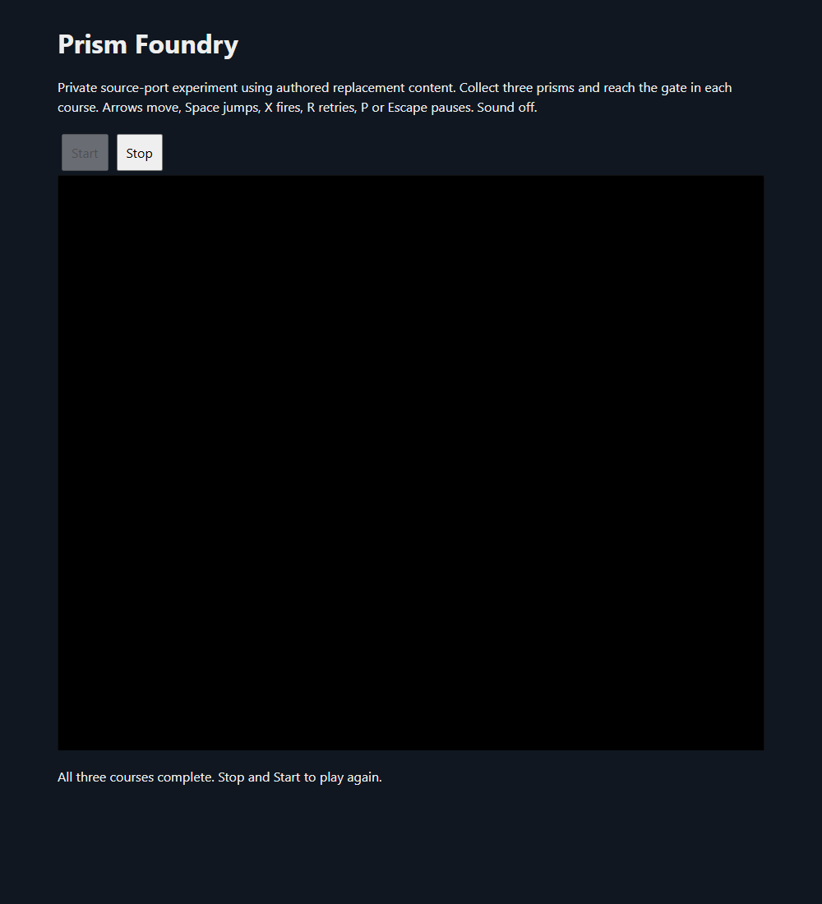

# Prism Foundry: earned three-course completion and loading cancellation

The private Moon Child FE source-port candidate now completes **Assembly Floor, Cooling Loop and Night Shift**, earns all **nine prisms**, activates each checkpoint and passes all three gates using ordinary keys. The native final victory flag is earned. The loading wrapper also handles cancellation before WASM initialization. This advances the earlier [partial-player checkpoint](prism-foundry-player-2026-10-15.md); it is not a release or additional decompilation. Catalog remains **90**.

## Readiness fix and verification

Emscripten exposes function stubs before the native module is ready. The previous wrapper tested only whether `_FoundryStatus` existed, which allowed an early observation to abort startup. The wrapper now sets a readiness flag from `onRuntimeInitialized`, returns `null` before that point, guards Stop and clears readiness after an abort. Stop during loading removes the player context and labels that outcome separately from observed native shutdown.

The revised smoke test delays the first WASM request for one second, observes `null` while export stubs exist, cancels loading, then starts normally. Movement/jump, pause/resume, disabled editor skip, retry, fresh restart and **two native shutdowns** all pass. No JavaScript exceptions or console errors occur. Edge **154.0.4258.62** was recorded, headless with `--mute-audio`. A temporary shutdown assertion failure came from an encoding error introduced in the test's expected text; using a Unicode escape corrected that test error.

The player was rebuilt through the existing verified recipe. Its **WASM and JavaScript hashes equal the preceding v3 candidate**; only the HTML wrappers changed. The authored content manifest is unchanged. The existing selected-code/dependency and retained-source-content qualifications still apply.

## Ordinary gameplay evidence

The campaign driver reads actor position, native tick/pickup state and course selection through the existing read-only exports. It sends ordinary directional and Space key actions, allows native inertia to settle, and stops positioning when a gate changes courses. It never writes game state, grants pickups or teleports.

| Course | Earned pickups | Activated checkpoint | Gate result |
| --- | --- | --- | --- |
| Assembly Floor | 1, 2, 3 | `(1168,584)` | Cooling Loop, zero-pickup spawn |
| Cooling Loop | 1, 2, 3 | `(1504,584)` | Night Shift, zero-pickup spawn |
| Night Shift | 1, 2, 3 | `(1696,712)` | `complete=1`, `paused=1` |

The first complete native run reaches victory after **6,149 unpaused native ticks**, with no respawns during that run. The earlier partial-player run separately exercised one gap fall/respawn while retaining two pickups. A successful hazard-free route does not by itself verify death or checkpoint restoration.

The original final fade leaves the canvas black, and the inner status was clipped by the iframe height. The wrapper now shows course, pickup count, pause and victory status outside the iframe. A second full playthrough reaches victory after **6,365 unpaused native ticks** and verifies the visible message, **“All three courses complete. Stop and Start to play again.”** Native Stop then succeeds. The rebuilt game WASM and JavaScript still match the previous candidate hashes; the new display is wrapper HTML.

The first progression driver incorrectly continued positioning toward the previous course's target after the first gate; its final observed course was already Cooling Loop. The revised driver stops positioning when a course changes. Early short direction taps could not finish the retained turn animation, so positioning now holds an ordinary direction until observed movement occurs. Attempts that missed pickups or overshot ledges are retained as failed input routes, not engine failures or full campaign passes. Game physics, map geometry, pickups and gate conditions were not changed to satisfy the route.

Checkpoint respawn, save support/restoration, shooting, broader animation/hazard paths, retained WebGL `INVALID_ENUM` warning, source-side content cleanup, final selected dependency/runtime notices, corresponding source packaging and production verification remain open. The original native rise/collapse death effect is still not part of the verified adapted fall/respawn path. No runtime was published or website deployed. Sound stayed off; audible sound remains unverified. Players and servers were closed after each attempt. Mario Party 2/3, Halo and private ROM research were untouched.

[Machine-readable checkpoint](prism-foundry-progression-2026-10-15.json).
