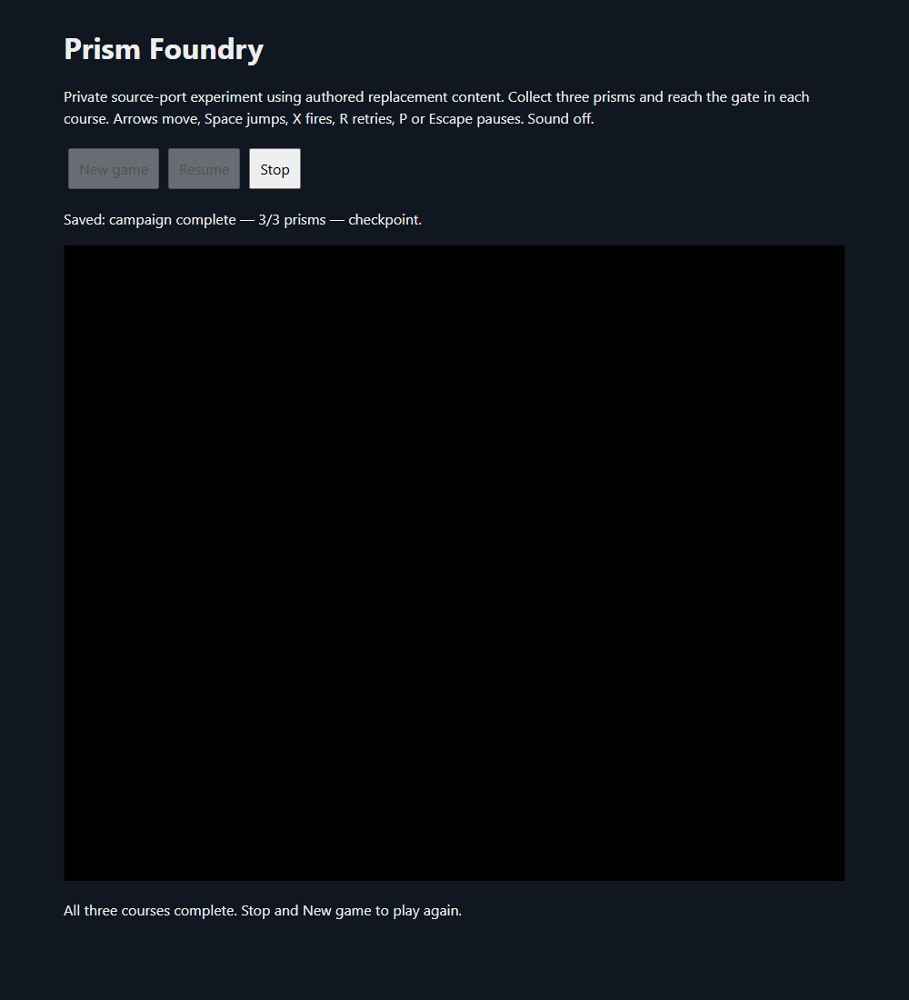

# Prism Foundry: earned saves across full browser restarts

The private developer-source port now saves and resumes its authored campaign. An earned two-prism checkpoint survives a **full browser close and restart**; a deliberate fall then respawns at that activated checkpoint with both pickups intact. The resumed run completes all three courses, and its earned victory survives a **second full browser restart**. This extends the earlier [campaign checkpoint](prism-foundry-progression-2026-10-15.md). **No catalog addition, new decompilation or production release.** Catalog remains **90**.

## What is stored and restored

The [authored codec](../experiments/prism-foundry-integration/save.js) stores a versioned record tied to the unchanged CC0 content-pack manifest SHA-256. Its fields are current course, three-bit prism identity mask, checkpoint activation and completion. Only the dedicated `decompgames.prism-foundry.progress.v1` localStorage key is read or written. No original save format, retail file, recording or arbitrary actor position is stored. New game starts fresh; Resume selects a validated existing record. The wrapper reports unavailable storage.

The native [progress adapter](../experiments/prism-foundry-integration/FoundryProgress.cpp) selects only an authored spawn or checkpoint, skips previously collected prism actors and sets the corresponding native pickup counter. A generated hook in the actual native diamond collision callback records pickup identity before its flying HUD effect finishes. Saving uses that identity mask, so it does not depend on the delayed HUD counter. The exact interruption-during-flight timing case has not been separately browser-tested.

The player recipe preserves the earlier `FoundryLevels.cpp` boundary-test source and generates a save-aware derivative privately. It compiles **eight changed/new units** and reuses **82 hash-verified native objects**. Strict linking, assertions and final-link SAFE_HEAP pass; this is not a full memory-safety certificate. Game WASM/JavaScript hashes change from the earlier no-save player. The authored pack bytes and manifest remain unchanged. The original code/media, SDK/dependency and source-content scopes remain separate.

## Measured verification

The codec test accepts **49 valid records**, rejects **23 malformed/incompatible records**, rejects three invalid live snapshots and passes one live-snapshot conversion. Rejections cover excessive text length, malformed JSON, wrong type/version/revision, out-of-range or noninteger course/mask, nonboolean flags, inconsistent terminal states and unknown fields.

The muted persistent-profile test uses Edge **154.0.4258.62** and ordinary keyboard controls:

1. Earns Assembly Floor's first two prisms and activates checkpoint `(1168,584)`. The actual save contains course `0`, mask `3`, checkpoint `true`, completion `false`.
2. Stops the native player, closes the full browser, launches a new browser process with the same test profile and origin, then clicks Resume. Native state reports `resumed=1`, two pickups, mask `3`, checkpoint `(1168,584)`, and actor `(1168,592)` after settling.
3. Walks left into the gap. The adapted respawn count becomes `1`, actor returns to `(1168,592)`, and both pickups/mask/checkpoint remain intact. This exercises the adapted native-`hoi_init` respawn path, not the original rise/collapse animation.
4. Earns the third prism, passes the first gate, then earns all remaining course pickups and gates. The native final state is course `2`, three pickups, mask `7`, checkpoint active, `complete=1`, `paused=1`.
5. Stops, closes the full browser again, launches the same profile and clicks Resume. The earned terminal record restores course `2`, mask `7`, three pickups, checkpoint active, `resumed=1`, `complete=1`, `paused=1`. The visible victory message remains.

The test **reads** its storage key; it does not seed saves, set pickup/completion flags, move actors through a debugger or teleport. Both pre-restart native Stop checks and the final native shutdown pass. The separate save-enabled smoke test also passes delayed-WASM loading cancellation, normal movement/jump, pause/resume, disabled editor skip, R retry, New game and two native shutdowns.

No JavaScript exceptions occur in the save/restoration run. The known renderer warning, `WebGL: INVALID_ENUM: disable: invalid capability`, repeats once per launched player and remains unresolved. Sound stays off; audible sound remains unverified. All test browsers and the local server are closed.

## Remaining release gates

Broader partial-save combinations in later courses, interruption during a flying pickup effect, corrupt/unavailable browser-storage integration, shooting and broader animation/hazard paths remain unverified. The initial-course checkpoint and final terminal save cases are the measured browser-restoration scope. Original source-side content cleanup, final selected SDK/runtime/dependency notices, source packaging, shipping allowlists, the renderer warning and muted production acceptance remain open. No runtime/source distribution was uploaded or website deployment performed. Mario Party 2/3, Halo and private ROM research were untouched. This is an original-developer source port with authored replacement content, not a clean-room certificate or an additional decompilation.

[Machine-readable checkpoint](prism-foundry-save-2026-10-15.json).
